# Shortcut style の Simulator 比較

iPad Pro 13-inch (M5) の iPadOS 26.5 Simulator を横向き（1376 × 1032 pt）にし、Xcode 27.2 の XCTest で撮影しました。Herdr 1 は `private-peer`、Herdr 2 は `private-core` のアプリ内 QA 接続です。ホスト設定には canvas v24 と同じ `prefix = "ctrl+a"` と `new_tab = ["prefix+c", "alt+t"]` を渡しました。XCTest で再現できる表示状態として、ソフトウェアキーボードを閉じた上でハードウェアキーボード利用フラグを設定しました。

| 画面 | canvas v24 | Simulator | 確認結果と差分 |
| --- | --- | --- | --- |
| Shortcuts（iPad） | 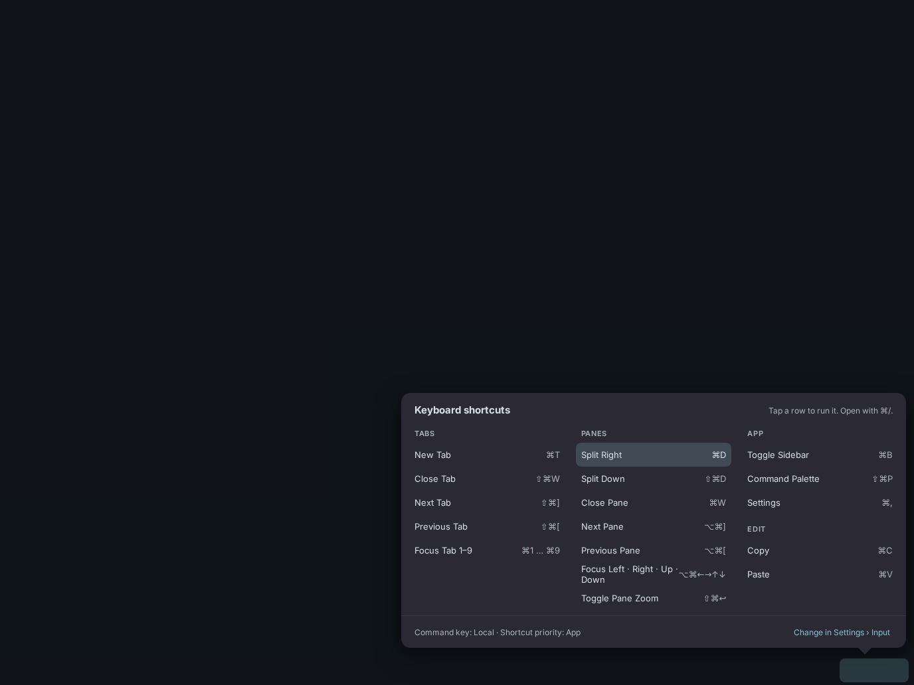 | 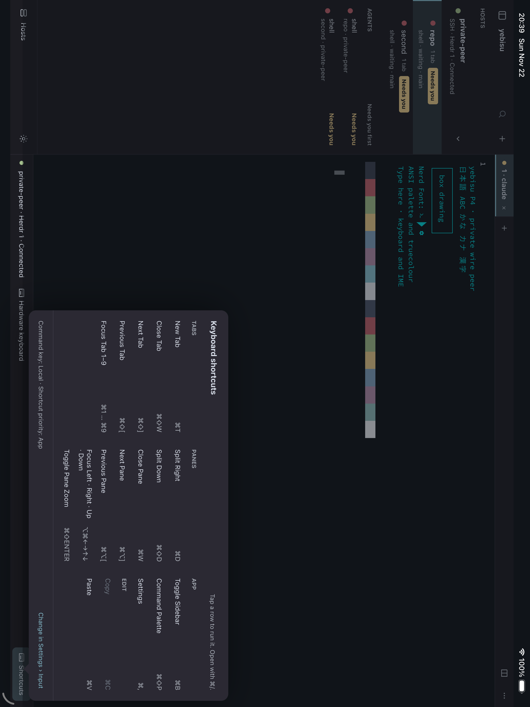 | ヘッダーに `Open with ⌘/.`、APP に `Settings  ⌘,` が出ます。修飾記号の順序と方向名の改行は、実アプリの既存のカタログ表示に従います。 |
| Shortcuts（Herdr prefix） | 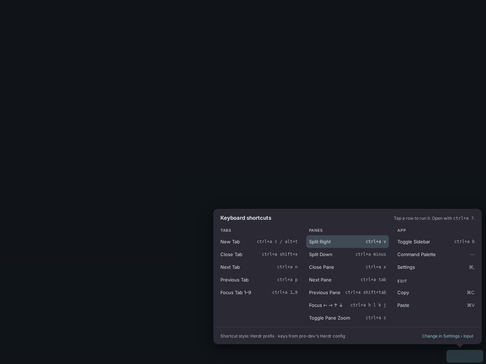 | 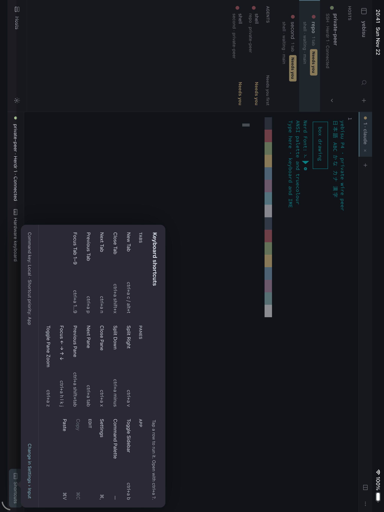 | `Open with ctrl+a ?.`、`ctrl+a c / alt+t`、`Focus ← → ↑ ↓  ctrl+a h l k j`、`Command Palette  —` が出ます。実アプリはフッターに Command key と Shortcut priority を出します。 |
| レール | 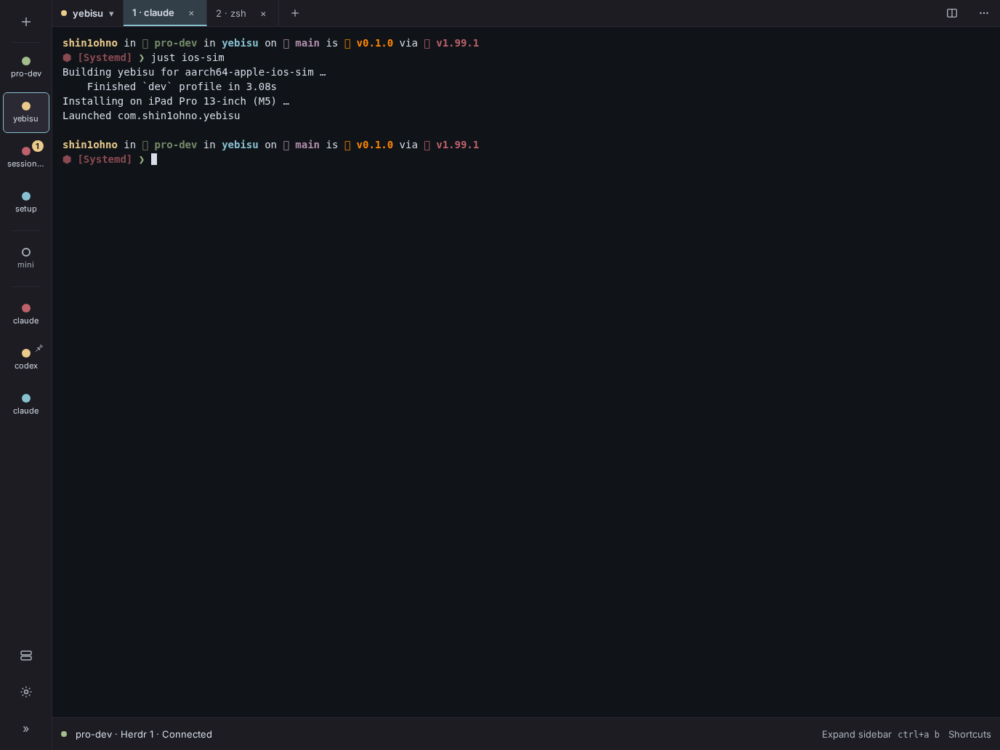 | 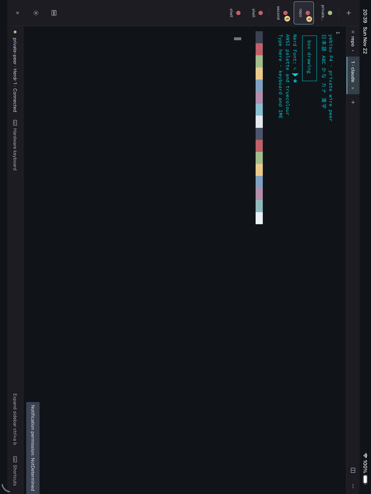 | ステータスバーに `Expand sidebar ctrl+a b` が出ます。実アプリの接続名とタブ内容は QA 接続のものです。 |
| Herdr 2 の … | 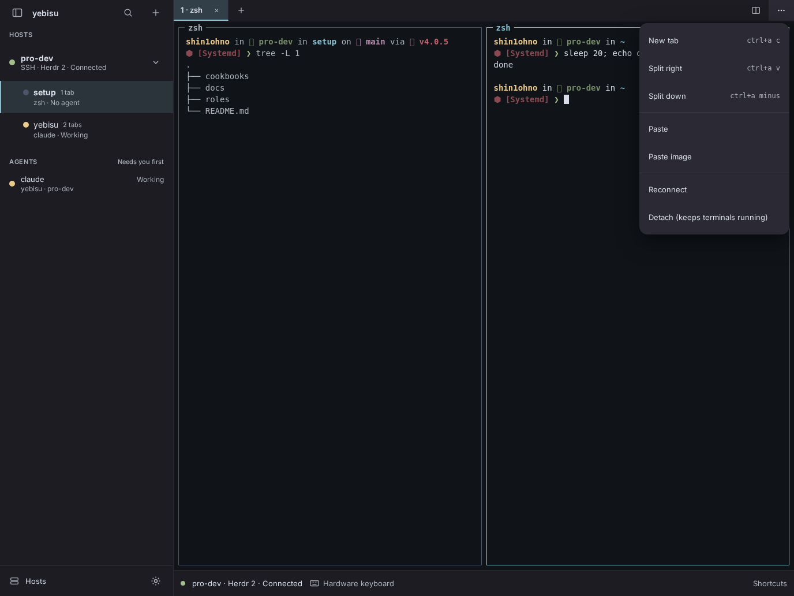 | 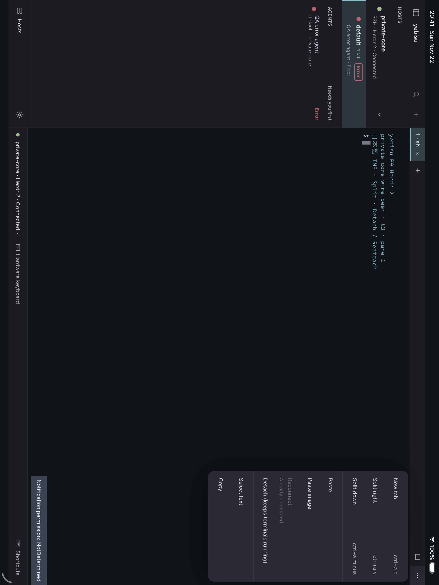 | 先頭3行に `ctrl+a c`、`ctrl+a v`、`ctrl+a minus` が出ます。QA 接続は1ペインのため、Split down を含む先頭3行が有効です。 |
| Settings › Input | 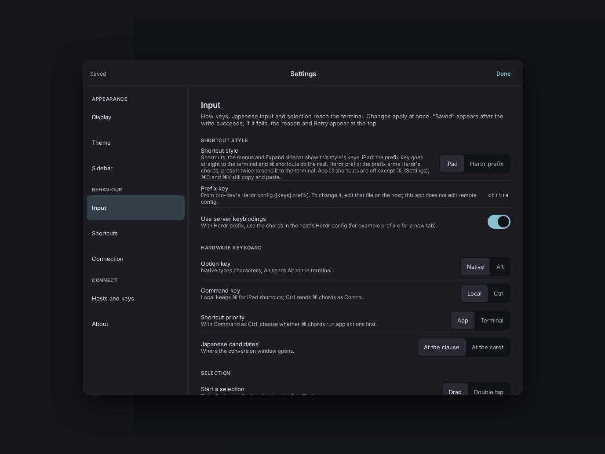 | 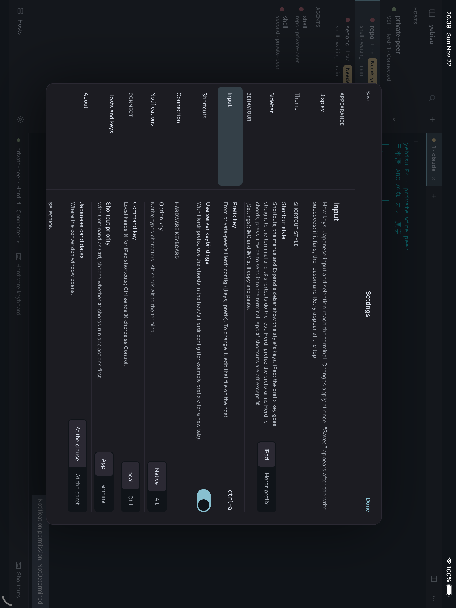 / 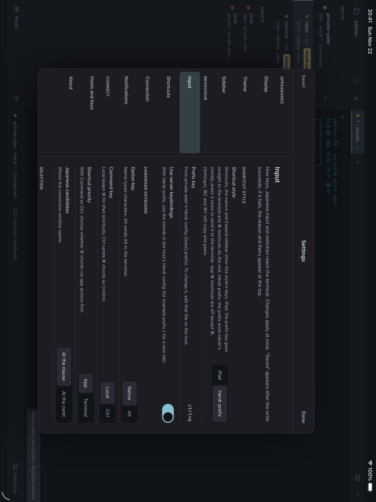 | 両スタイルで v24 の説明文を表示します。実アプリのシート幅に合わせて説明を折り返します。 |
| Settings › Shortcuts |  | 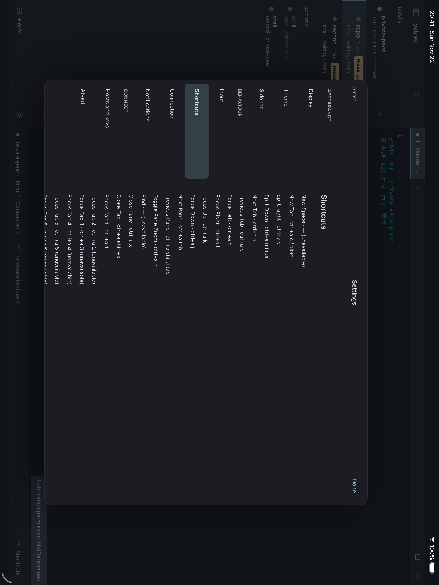 | 一覧には `New Tab · ctrl+a c / alt+t` が出ます。未割当は `—` で、実行できないコマンドには既存の `(unavailable)` 表示が付きます。 |

Simulator の通知権限が未選択のため、一部の画像右下にアプリの状態表示が出ています。
